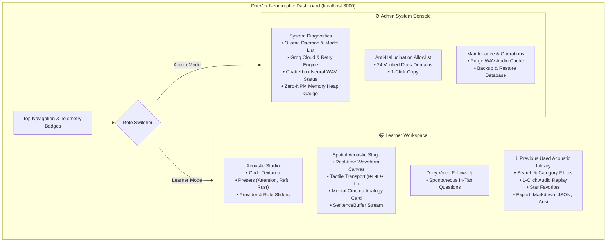
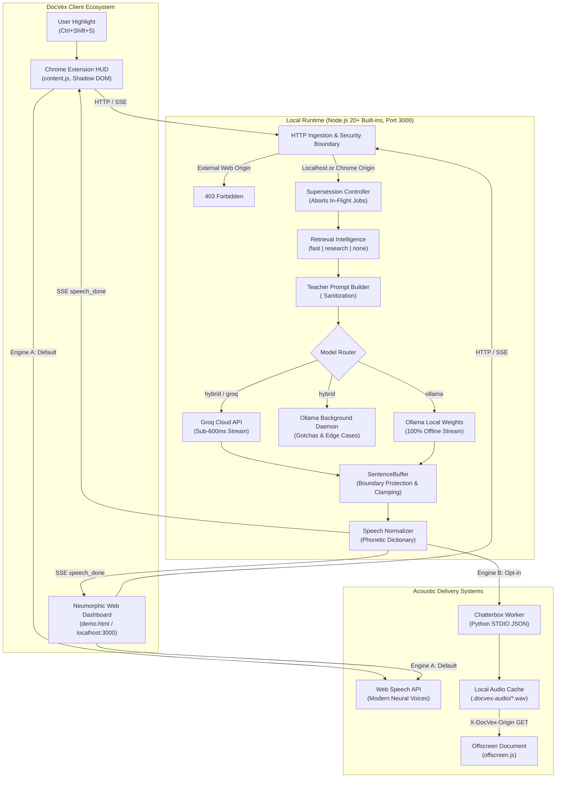

<div align="center">

# DOCVEX

### ❝ Hear your documentation. ❞

` ▂ ▃ ▅ ▆ ▇ █ ▇ ▆ ▅ ▃ ▂   ACOUSTIC TECHNICAL TUTOR   ▂ ▃ ▅ ▆ ▇ █ ▇ ▆ ▅ ▃ ▂ `

<br/>

[](https://opensource.org/licenses/MIT)
[](https://nodejs.org/)
[](extension/manifest.json)
[](demo.html)
[-00C853?style=for-the-badge&logo=checkmarx&logoColor=white)](server/test/)
[](package.json)
[](server/config.js)

<br/>

**DocVex** is an offline-first acoustic learning engine and interactive technical tutor for developers. Built on a zero-dependency local Node.js runtime, it pairs an in-tab Manifest V3 Chrome Extension with a tactile **Dark Neumorphic Acoustic Dashboard**, transforming complex algorithmic syntax, distributed system specs, and documentation into spatial spoken mental models at sub-600ms latency.

</div>

---

## 🎯 Why DocVex Exists: The Acoustic Cognitive Advantage

> *"Reading code gives you syntax; hearing it constructed in physical space gives you intuition. DocVex bridges the gap between mechanical notation and spatial mental models — spoken aloud at zero latency on your own hardware."*

Software engineers spend over $60\%$ of their working hours reading dense technical documentation, RFC specifications, and unfamiliar algorithmic codebases. Yet human visual working memory is notoriously prone to **visual syntactic fatigue**:
- **The Syntax Glaze**: When scanning complex algorithms (e.g. `arr[i] !== x`, `O(n log n)`, `std::unique_ptr`), developer eyes glaze over the punctuation while cognitive comprehension stalls.
- **Dual-Coding Deficit**: Traditional developer tooling forces all comprehension through a single bandwidth-constrained visual sensory channel.
- **Auditory Spatial Immersion**: Human evolutionary hardware is wired to comprehend mechanics through narrative spatial acoustics. When algorithms are constructed physically in 3D mental space (e.g., sliding windows as movable optical apertures, microtasks as VIP bypass gates), comprehension speed multiplies.

```text
┌──────────────────────────────────────────────────────────────────────────────┐
│                    THE ACOUSTIC COGNITIVE ADVANTAGE                          │
│                                                                              │
│   Visual Reading Only:                                                       │
│   [ Code Syntax ]  ──────>  ( Visual Working Memory )  ──────> Fatigue       │
│                                                                              │
│   DocVex Dual-Coding:                                                        │
│   [ Code Syntax ]  ──────>  ( Visual Working Memory )  ─┐                     │
│                                                         ├────> Deep Intuition│
│   [ Spoken Mental Cinema ] > ( Auditory Working Memory )─┘                     │
└──────────────────────────────────────────────────────────────────────────────┘
```

DocVex implements **Dual-Coding Theory** for software engineers: you read the code while hearing its physical mechanics spoken aloud, eliminating comprehension latency while staying $100\%$ air-gapped on your own machine.

---

## ⚡ Technical Highlights

```text
┌─────────────────┐     ┌─────────────────────┐     ┌──────────────────────┐
│  AUDIO STREAM   │     │   LOCAL INFERENCE   │     │   LATENCY ENVELOPE   │
│ Web Speech API  │     │ Ollama (qwen3:4b)   │     │  < 600ms Time To     │
│ + Chatterbox WAV│     │ 100% On-Device      │     │  First Sentence      │
└─────────────────┘     └─────────────────────┘     └──────────────────────┘
┌─────────────────┐     ┌─────────────────────┐     ┌──────────────────────┐
│  DOC GROUNDING  │     │   VOICE INTERRUPT   │     │   SECURITY BOUNDARY  │
│ 24 Authoritative│     │ Web Audio VAD +     │     │ Zero NPM Runtime Deps│
│ Domain Allowlists│    │ Bilingual Wake Words│     │ Strict Zero-innerHTML│
└─────────────────┘     └─────────────────────┘     └──────────────────────┘
┌─────────────────┐     ┌─────────────────────┐     ┌──────────────────────┐
│  NEUMORPHIC HUB │     │   DATA VAULT & ANKI │     │   SUPERSEDED JOBS    │
│ Dual Workspace  │     │ Search, Replay,     │     │ Instant Abort on     │
│ (Learner/Admin) │     │ Multi-Format Export │     │ Newer Selections     │
└─────────────────┘     └─────────────────────┘     └──────────────────────┘
```

- **Spatial Mental Cinema**: Translates algorithms into physical spatial mechanics (e.g., sliding windows as movable optical apertures, arrays as indexed storage lockers) with concrete dry-runs.
- **Phonetic Normalization**: Live regex phonetics compiler transforms syntax into natural spoken language (`O(n log n)` ➔ *"order of n log n"*, `arr[i] !== x` ➔ *"array at index i is not equal to x"*).
- **Streaming Sentence Buffer**: Splits SSE token streams at clause boundaries (clamped to $\le 360$ chars), protects decimals and abbreviations (`3.14`, `e.g.`), and schedules paragraph-level acoustic pauses ($1000\text{ms}$).
- **Bilingual Voice Interrupt (Docy)**: Real-time microphone listener with acoustic self-echo rejection detecting English and Hindi wake words (`wait`, `listen`, `ruko`, `ruk ja bhai`, `doubt`) to pause playback and handle spontaneous voice questions.
- **Neumorphic Acoustic Dashboard**: Tactile soft-UI web management hub (`http://localhost:3000`) with **Learner Workspace**, **Admin System Console**, real-time audio waveform visualizer, and **Previous Used Data Vault** (modeled after Wispr Flow's notetaker & history hub).
- **Provider Tri-Routing**:
  - `ollama`: $100\%$ air-gapped, on-device inference using local GGUF models.
  - `groq`: Ultra-low latency cloud streaming with automatic exponential backoff retry.
  - `hybrid`: Groq streams spoken audio instantly while local Ollama computes background architectural gotchas and pitfalls concurrently.

---

## 🎛️ The Neumorphic Dashboard (`http://localhost:3000`)

DocVex features a standalone **Dark Neumorphic Learning & System Dashboard** served directly by the zero-dependency Node.js runtime. Built with soft-UI extruded surfaces (`#0c1017` dark obsidian base, debossed inset inputs, and illuminated status indicators), the dashboard provides two specialized consoles:



### 1. 🎧 Learner Workspace Features
- **Acoustic Learning Studio**: Paste any complex code or documentation snippet, or load 1-click presets (`Scaled Attention`, `Microtask Starvation`, `Raft Consensus`, `Rust Ownership`, `Zero-Copy I/O`).
- **Real-Time SentenceBuffer Stream**: Watch sentences segmented and clamped live as tokens arrive over Server-Sent Events (SSE), with visual badges indicating paragraph pauses ($+1000\text{ms}$).
- **Tactile Playback Controls**: Full transport controls (Play/Pause, Next Sentence, Previous Sentence, Replay Current Sentence, Speed 0.75x–1.75x) with keyboard shortcut support.
- **Previous Used Acoustic Library ("Previous Used")**:
  - Centralized vault storing all previously generated mental models and acoustic transcripts.
  - Search by topic title, code syntax, or mental model analogy.
  - Filter by category (`Algorithms`, `Distributed Systems`, `Runtimes`, `Cloud/DevOps`, `Frontend`, or `⭐ Starred`).
  - **Multi-Format Export**: Export library to clean **Markdown**, structured **JSON**, or import-ready **Anki Study Decks** (with spaced repetition tags).

### 2. ⚙️ Admin System Console Features
- **Engine Topology Diagnostics**: Live status indicators for Ollama daemon, installed models list, Groq cloud quota, and Chatterbox PyTorch neural device (`MPS`, `CUDA`, or `CPU`).
- **Grounding Domain Allowlist (Anti-Hallucination)**: Live inspection of all 24 verified documentation domains (`developer.mozilla.org`, `kubernetes.io`, `rust-lang.org`, `docs.python.org`, etc.).
- **Cache & Storage Maintenance**: One-click audio cache purge (`POST /api/cache/purge`) to remove temporary neural WAV files from `.docvex-audio/`.

---

## 📐 Architecture



---

## 🔊 The Speech Pipeline

DocVex bridges raw code syntax and acoustic comprehension through a multi-stage streaming pipeline:

```text
  INPUT TOKEN STREAM (Ollama / Groq SSE)
           │
           ▼
  ┌─────────────────────────────────────────────────────────┐
  │ 1. SentenceBuffer Accumulator                           │
  │    • Boundary protection: ignores dots in decimals      │
  │      ("3.14") and abbreviations ("e.g.", "i.e.", "vs.") │
  │    • Clause clamping: splits long sentences (>360 chars)│
  │      at natural punctuation (, ; - :)                   │
  │    • Dynamic pauses: 1000ms on \n\n, 0ms intra-paragraph│
  └────────────────────────┬────────────────────────────────┘
                           │
                           ▼
  ┌─────────────────────────────────────────────────────────┐
  │ 2. Text Shaping & Sanity Scrubbing                      │
  │    • Strips markdown artifacts, code ticks, raw URLs    │
  └────────────────────────┬────────────────────────────────┘
                           │
                           ▼
  ┌─────────────────────────────────────────────────────────┐
  │ 3. Phonetic Normalization (speechNormalization.js)      │
  │    • Code operators: !==  ➔ "is not equal to"           │
  │    • Complexity:     O(n) ➔ "order of n"                │
  │    • Tooling:     kubectl ➔ "kube control"              │
  │    • Data structures: a[i]➔ "a at index i"              │
  └────────────────────────┬────────────────────────────────┘
                           │
             ┌─────────────┴─────────────┐
             ▼                           ▼
  ┌───────────────────────┐   ┌─────────────────────────────┐
  │ In-Tab Web Speech API │   │ Local Chatterbox Worker     │
  │ • Zero dependencies   │   │ • Neural WAV generation     │
  │ • Instant sentence 1  │   │ • Sentence-pipelined queue  │
  │ • 15s keepAlive pulse │   │ • Gapless offscreen buffer  │
  └───────────────────────┘   └─────────────────────────────┘
```

### Phonetic Translation Matrix

| Raw Syntax | Acoustic Speech Normalization | Context |
| :--- | :--- | :--- |
| `O(n log n)` | *"order of n log n"* | Computational complexity |
| `kubectl exec` | *"kube control exec"* | Infrastructure tooling |
| `gRPC` | *"gee R P C"* | Distributed protocols |
| `===` / `!==` | *"strictly equals"* / *"is not equal to"* | Equality operators |
| `arr[i]` | *"array at index i"* | Array index notation |
| `std::vector` | *"standard vector"* | C++ namespaces |

---

## 🛡️ Security & Privacy Invariants

DocVex is engineered with strict defensive boundaries:

1. **Air-Gapped Data Boundary (`DEFAULT_PROVIDER=ollama`)**:
   - Zero telemetry, zero analytics, zero external HTTP calls.
   - Selected text and DOM context never leave `127.0.0.1`.
2. **Zero NPM Runtime Dependencies**:
   - Built exclusively on Node.js standard modules (`node:http`, `node:fs`, `node:child_process`, `node:test`).
   - Zero attack surface from supply-chain compromises.
3. **Strict Zero-`innerHTML` Policy**:
   - Extension HUD and Dashboard construct dynamic DOM strictly via `document.createElement()`, `textContent`, and `replaceChildren()`.
   - `eval()`, `new Function()`, and raw HTML injections are permanently forbidden and verified via automated AST test suites.
4. **Origin Lockdown (HTTP 403)**:
   - Node.js backend inspects the `Origin` header. Requests originating from arbitrary external web pages are blocked with `403 Forbidden`. Only `localhost`, `127.0.0.1`, `chrome-extension://` IDs, and CLI clients are authorized.
5. **Chatterbox Audio Guard**:
   - WAV audio endpoints validate origin headers matching `EXTENSION_ORIGIN` to prevent cross-extension resource theft.

---

## 🚀 Quick Start

### 1. Prerequisites
- **Node.js** v20.6.0+ (native `.env` and `node:test` support)
- **Google Chrome** (or Chromium derivative: Brave, Edge, Arc)
- **Ollama** ([ollama.com](https://ollama.com)) for offline mode

### 2. Setup & Boot

```bash
# Clone repository
git clone https://github.com/harshakumar25/DOCVEX.git
cd DOCVEX

# Copy environment config
cp .env.example .env

# Pull default local tutor model
ollama pull qwen3:4b

# Start the DocVex server (Port 3000)
npm start
```

### 3. Open the Neumorphic Dashboard
Open your browser and navigate to:
```text
http://localhost:3000/
```
From the dashboard you can immediately:
- Test any technical passage or preset in the **Learner Workspace**.
- Review past explanations in the **Previous Used Acoustic Library**.
- Inspect system health and purge audio cache in the **Admin Console**.

### 4. Load the Chrome Extension (Optional)
1. Navigate to `chrome://extensions/` in Chrome.
2. Toggle **Developer mode** (top-right).
3. Click **Load unpacked** and select the `extension/` directory.
4. Verify shortcut under `chrome://extensions/shortcuts` (Default: `Ctrl+Shift+S` or `MacCtrl+Shift+S`).
5. Highlight any technical paragraph on any documentation site ➔ Press `Ctrl+Shift+S`.

---

## 📡 API Reference

The DocVex Node.js runtime exposes zero-dependency REST and SSE endpoints:

| Endpoint | Method | Description | Origin Policy |
| :--- | :--- | :--- | :--- |
| `/` or `/dashboard` | `GET`, `HEAD` | Serves the standalone Neumorphic Learning Dashboard | Public local |
| `/manifest.webmanifest` | `GET`, `HEAD` | PWA installation manifest for standalone desktop/mobile shell | Public local |
| `/sw.js` | `GET`, `HEAD` | Zero-dependency Service Worker for offline shell caching | Public local |
| `/health` | `GET` | System health probe (Ollama, Groq, Chatterbox) | Extension / Local |
| `/api/system/stats` | `GET` | Detailed hardware topology, uptime, and memory heap | Extension / Local |
| `/api/retrieval/domains` | `GET` | List of 24 verified anti-hallucination doc domains | Extension / Local |
| `/api/cache/purge` | `POST` | Safely purges temporary neural WAV audio files | Extension / Local |
| `/teach` | `POST` | Primary acoustic explanation engine (supports SSE streaming) | Extension / Local |
| `/audio/:file` | `GET` | Streams generated Chatterbox neural WAV audio | Origin-guarded |

---

## ⚙️ Configuration Reference

All settings reside in `.env` (managed via `server/config.js`):

| Variable | Default | Permitted Values | Function |
| :--- | :--- | :--- | :--- |
| `PORT` | `3000` | `1024 - 65535` | HTTP server listening port |
| `DEFAULT_PROVIDER` | `hybrid` | `ollama`, `groq`, `hybrid` | Inference strategy |
| `OLLAMA_HOST` | `http://127.0.0.1:11434` | Valid URL | Local Ollama daemon endpoint |
| `OLLAMA_MODEL` | `qwen3:4b` | Any installed Ollama model | Model identifier for local inference |
| `GROQ_API_KEY` | `""` | `gsk_...` | API key for cloud speed (optional) |
| `GROQ_MODEL` | `openai/gpt-oss-20b` | Valid Groq model ID | Cloud streaming model |
| `MAX_SELECTION_LENGTH`| `12000` | Positive integer | Character truncation limit on input text |
| `RETRIEVAL_TIMEOUT_MS`| `2500` | Milliseconds | Authoritative reference query ceiling |
| `CHATTERBOX_ENABLED` | `false` | `true`, `false` | Opt-in local neural WAV voice generation |
| `EXTENSION_ORIGIN` | `""` | `chrome-extension://<id>`| Extension origin requirement for `/audio` |

---

## 🧪 Engineering Verification Matrix

DocVex maintains a zero-dependency test suite run via Node.js native test runner (`node:test`). Every architectural contract is formally asserted.

```bash
# Execute entire test suite
npm test

# Run syntax lint checks
npm run lint
```

### Coverage by Subsystem (98 Tests Passing)

```text
  ✔ ALL 98 SPECIFICATIONS PASSING (0 EXTERNAL DEPENDENCIES)
```

| Verification Domain | Test Suite | Core Assertions Verified |
| :--- | :--- | :--- |
| **Dashboard & Management API** | `dashboard_api.test.js` | • Serves Neumorphic Dashboard with 200 OK on `/`, `/demo`, `/demo.html`, and `/dashboard`<br/>• Serves offline PWA assets (`/manifest.webmanifest`, `/sw.js`)<br/>• Returns system stats, uptime, memory, and provider status on `/api/system/stats`<br/>• Blocks forbidden external origins on stats with HTTP 403<br/>• Safely purges temporary WAV cache files on `/api/cache/purge`<br/>• Exports 24 verified documentation domains on `/api/retrieval/domains` |
| **Transport & Protocol** | `server.test.js`<br/>`streaming.test.js`<br/>`cancellation.test.js` | • Blocks arbitrary web `Origin` with HTTP 403<br/>• Reconstructs SSE packets split across TCP chunk boundaries<br/>• Active `AbortController` supersession cancels upstream fetch on new selection<br/>• Enforces 1 MB payload limits and input schema constraints |
| **Acoustic Buffer & Shaping** | `sentenceBuffer.test.js`<br/>`providers.test.js` | • Suppresses false splits on decimals (`3.14`) and abbreviations (`e.g.`, `vs.`)<br/>• Clamps sentences to $\le 360$ chars at clause boundaries without word mutilation<br/>• Classifies paragraph pause boundaries ($1000\text{ms}$ vs $0\text{ms}$)<br/>• Translates notation into phonetics without altering HUD transcript text |
| **Interactive Voice Interrupt** | `docy_interrupt.test.js` | • Bilingual wake detection (English: *wait*, *listen* / Hindi: *ruko*, *ruk ja bhai*, *sun*)<br/>• Acoustic self-echo cancellation discards synthetic speaker feedback<br/>• Dynamic countdown resets on detected speech activity<br/>• Formulates contextual follow-up prompts using conversational history |
| **Extension Safety & MV3** | `dom_safety.test.js`<br/>`extension.test.js` | • AST scan verifies complete absence of `innerHTML`, `eval()`, and `new Function()`<br/>• Enforces Shadow DOM styling isolation (`mode: 'open'`)<br/>• Verifies Manifest V3 compliance and required permission declarations |
| **Resilience & Fallback** | `groq_resilience.test.js`<br/>`hybrid_pipeline.test.js` | • Exponential backoff retry on HTTP 429 and 503<br/>• Seamless runtime fallback to Ollama if cloud stream fails<br/>• Asynchronous coordination: Groq audio streams immediately while Ollama Gotchas compute in background |
| **Grounding & Retrieval** | `retrieval.test.js`<br/>`retrievalIntelligence.test.js` | • Triage routing: `fast` (local DOM), `research` (allowlist), `none` (trivial text)<br/>• Strict `<evidence>` boundary protection against prompt injection<br/>• Allowlist enforcement across 24 authoritative engineering domains |

---

## 🛠️ Tactical Diagnostic Grid

Fast triage table for common operational issues:

| Symptom | Probable Cause | Terminal Resolution |
| :--- | :--- | :--- |
| `EADDRINUSE: 3000` | Port 3000 occupied by previous process | `lsof -ti:3000 \| xargs kill -9` or update `PORT=3005` in `.env` |
| `ECONNREFUSED: 11434` | Local Ollama daemon is offline | Run `ollama serve` in a dedicated shell |
| `Model unavailable: qwen3:4b` | Model weights not downloaded | Run `ollama pull qwen3:4b` |
| `Invalid Groq API key` / `401` | Missing or invalid key in cloud mode | Set `GROQ_API_KEY=gsk_...` in `.env` or set `DEFAULT_PROVIDER=ollama` |
| `HTTP 403 on /audio/:file` | Extension origin mismatch in Chatterbox | Copy extension ID from `chrome://extensions/` ➔ set `EXTENSION_ORIGIN=chrome-extension://<id>` in `.env` |
| HUD shows `Disconnected` | Extension popup configured with wrong port | Click DocVex extension icon ➔ enter matching port ➔ click **Save** |

---

## 📁 Repository Layout

```text
DOCVEX/
├── demo.html                      # Standalone Neumorphic Learning & System Dashboard
├── extension/                     # Chrome Manifest V3 Client
│   ├── background.js              # Service worker & SSE stream proxy
│   ├── content.js                 # Shadow DOM HUD (0-innerHTML) & Docy voice interrupt
│   ├── offscreen.html / .js       # Offscreen audio document for neural WAV streaming
│   ├── popup.html / .js           # Connection telemetry & provider switchboard
│   └── manifest.json              # Manifest V3 permission declarations
├── server/                        # Core Zero-Dependency Node.js Server
│   ├── config.js                  # Environment parsing & boundary validation
│   ├── pipeline.js                # SSE streaming coordinator & fallback controller
│   ├── server.js                  # HTTP server, origin security & supersession
│   ├── plugins/                   # Zero-Dependency Developer Plugins Subsystem
│   │   └── pluginManager.js       # 8 real plugins registry, execution & toggle router
│   ├── prompt/                    # Prompts & Speech Formatting
│   │   ├── teacherPrompt.js       # Spatial mental models & DSA cinema prompt
│   │   ├── reasoningPrompt.js     # Background gotchas & executive summary prompt
│   │   ├── sentenceBuffer.js      # Token accumulation & clause clamping (<=360 chars)
│   │   └── speechNormalization.js # Phonetic dictionary & syntax-to-speech compiler
│   ├── providers/                 # Model & Speech Providers
│   │   ├── providerFactory.js     # Provider selection & streaming dispatcher
│   │   ├── ollamaProvider.js      # Local HTTP client (100% offline)
│   │   ├── groqProvider.js        # Low-latency streaming client with retry backoff
│   │   └── chatterboxProvider.js  # STDIO JSON worker interface for neural audio
│   ├── retrieval/                 # Authoritative Context Retrieval
│   │   ├── trustedSources.js      # 24 authoritative engineering doc domains
│   │   ├── retrievalIntelligence.js # Pre-fetch triage engine (fast | research | none)
│   │   └── referenceEngine.js     # HTML sanitizer & scoped DDG search client
│   └── test/                      # Native Test Runner (113 specs, node:test)
│       ├── plugins.test.js        # 8 plugins & REST execution specifications
│       ├── dashboard_api.test.js  # Dashboard REST & security origin specifications
│       ├── server.test.js         # HTTP protocol & supersession tests
│       ├── streaming.test.js      # SSE parsing & chunk reconstruction tests
│       └── ...                    # Acoustic buffer, Docy interrupt & resilience tests
├── manifest.webmanifest           # PWA offline application manifest
├── sw.js                          # Service worker cache & offline fallback engine
├── chatterbox/                    # Optional Neural TTS Subsystem (Python)
│   ├── docvex_worker.py           # Long-lived STDIO worker for PyTorch neural voice
│   └── pyproject.toml             # Torch & torchaudio dependencies
└── package.json                   # Zero-dependency ESM package manifest
```

---

## 🔌 Developer Plugins Subsystem (Zero NPM Dependencies)

DocVex includes **8 production-ready developer plugins** designed for daily engineering workflows. Every plugin is implemented with pure standard ECMAScript, runs completely offline, and enforces strict input sanitization.

| Plugin ID | Name | Category | Real Capability & Output Format |
| :--- | :--- | :--- | :--- |
| `obsidian-vault` | Obsidian Knowledge Exporter | Knowledge Base | Exports sessions as Obsidian Markdown with YAML frontmatter, `[[wikilinks]]`, tags, and callouts (`[!abstract]`, `[!example]`, `[!warning]`). |
| `anki-deck` | Anki Spaced-Repetition Generator | Active Recall | Produces tab-separated TSV flashcards with Cloze deletions (`{{c1::...}}`) for automated Anki desktop and mobile import. |
| `git-diff-auditor` | Git Diff Acoustic Auditor | VCS & Review | Parses unified git diff patches, filters boilerplate noise, computes structural additions/deletions, and scripts an acoustic architectural briefing. |
| `dsa-cinema` | DSA Mental Cinema Deconstructor | Algorithms | Deconstructs algorithmic patterns (Sliding Window, Two Pointers, Monotonic Stack, Topological Sort) into spatial ASCII diagrams and invariant rules. |
| `podcast-compiler` | Podcast & Commute Episode Compiler | Audio Production | Stitches multiple library sessions into continuous episodic audio walkthroughs with chapter markers, introduction, and transition pauses. |
| `system-design-architect` | Distributed Systems Architect | Databases & Systems | Deconstructs distributed consensus (Raft), partitioning (Consistent Hashing), and storage engines (LSM-trees) into failure domains, CAP classifications, and ASCII topologies. |
| `regex-decoder` | Regex Verbal Decoder & ReDoS Guard | Dev Tools | Translates complex regular expressions into plain-English verbal walkthroughs, breaks down structural assertions, and audits catastrophic backtracking (ReDoS) hazards. |
| `sql-explain-analyst` | SQL Explain Query Plan Analyst | Databases & Systems | Parses `EXPLAIN / EXPLAIN ANALYZE` query plans, pinpoints expensive sequential full-table scans, sort spills to disk, and formulates spoken tuning advice. |

### Plugin REST API Reference

```bash
# 1. List all registered plugins and status
curl -s http://127.0.0.1:3000/api/plugins

# 2. Execute a specific plugin with payload
curl -s -X POST http://127.0.0.1:3000/api/plugins/execute \
  -H "Content-Type: application/json" \
  -d '{"pluginId": "dsa-cinema", "input": {"pattern": "two-pointers"}}'

# 3. Toggle a plugin on or off
curl -s -X POST http://127.0.0.1:3000/api/plugins/toggle \
  -H "Content-Type: application/json" \
  -d '{"pluginId": "regex-decoder", "enabled": true}'
```

### 🧠 Binaural 40Hz Gamma Focus Ambience
Built directly into the **Spatial Acoustic Stage** of `demo.html`, the Focus Soundscape engine generates real-time binaural auditory entrainment via the browser's native `AudioContext` (Web Audio API):
- **Binaural Gamma (40Hz)**: 200 Hz left ear / 240 Hz right ear for deep focus and neuroplastic coding retention.
- **Warm Brown Noise**: Low-pass filtered (420 Hz) randomized brown noise to mask distracting office or transit environments.
- **Zero Assets**: 100% synthesized through native oscillators and buffer sources without downloading audio files.

---

## 📜 License

Distributed under the [MIT License](https://opensource.org/licenses/MIT).

