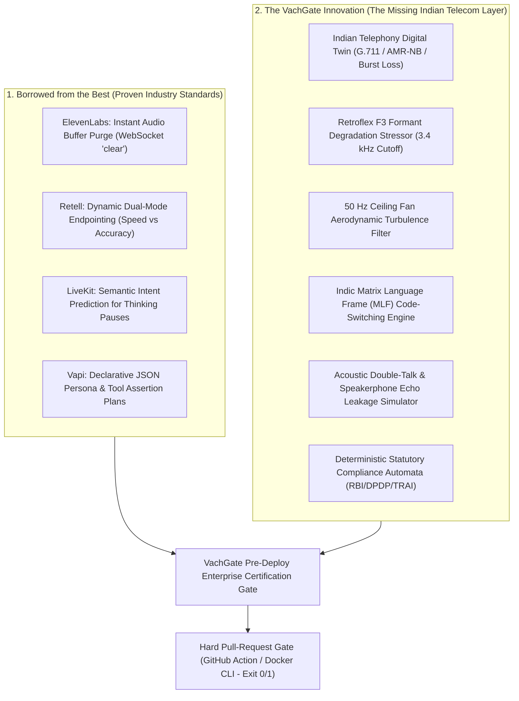

# Competitive Architecture Teardown & Next-Generation Telephony Certification Engine
## Benchmarking ElevenLabs, Retell AI, Vapi.ai, and LiveKit to Architect the Canonical Pre-Deploy Certification Gate for Indic Enterprise Telephony

**Document Version:** 3.0.0-COMPETITIVE-SYNTHESIS  
**Classification:** Enterprise System Architecture, Market Intelligence & Technical Specification  
**Focus:** Engineering Mechanisms of Latency, Barge-In, Turn-Taking, Telephony Codecs, and Sovereign Compliance

---

## 1. Executive Competitive Landscape

The global conversational Voice AI market has bifurcated into two distinct layers:
1. **The Infrastructure & Model Layer (Western SaaS Titans):**
   - **ElevenLabs:** Uncontested leader in synthetic audio fidelity, neural prosody, and emotional expression. Launched Conversational AI with native Twilio WebSocket bridges.
   - **Retell AI:** Opinionated, high-performance voice agent runtime optimized for low latency (<600ms) and out-of-the-box turn-taking.
   - **Vapi.ai:** Developer-first modular orchestrator allowing arbitrary composition of STT (Deepgram/AssemblyAI), LLM (Groq/OpenAI/Anthropic), and TTS (ElevenLabs/Cartesia).
   - **LiveKit Agents:** Open-source WebRTC standard for full-duplex bi-directional voice streaming with semantic turn detection.
   - **Cartesia:** Pioneer of state-space (Mamba-based) streaming TTS, delivering sub-100ms Time-to-First-Audio.

2. **The Indic Enterprise & Sovereign Telephony Reality (Gnani, Skit, Sarvam, Yellow):**
   - Operating in regulated, cost-sensitive Indian BFSI contact centers (HDFC, SBI, ICICI, Bajaj Finserv).
   - Handling calls routed over legacy Indian cellular networks (Jio VoLTE, Airtel PRI, Tata Tele SBCs) compressed to 8 kHz G.711 / AMR-NB.
   - Navigating strict statutory frameworks: **Reserve Bank of India (RBI)** fair practices, **DPDP Act 2023** on-premise data localization, and **TRAI 1600-series** mandates.

```
┌─────────────────────────────────────────────────────────────────────────────────────────────┐
│                           The Global vs. Indic Market Divergence                           │
├──────────────────────────────┬──────────────────────────────┬───────────────────────────────┤
│ Dimension                    │ Western Voice Giants         │ Indian Enterprise Reality     │
│                              │ (ElevenLabs / Retell / Vapi) │ (Gnani / BFSI Banking Trunks) │
├──────────────────────────────┼──────────────────────────────┼───────────────────────────────┤
│ Audio Bandwidth              │ 24 kHz / 48 kHz Wideband     │ 8 kHz G.711 / AMR-NB          │
│ Cost Ceiling per Call        │ $0.08 - $0.20 / minute       │ ₹2 - ₹4 ($0.02 - $0.05) total │
│ Cloud & Data Sovereignty     │ US/EU Multi-tenant SaaS      │ Air-Gapped / Private VPC      │
│ Primary Linguistic Style     │ Standard Monolingual English │ Intra-sentential Code-Mixing  │
│ Verification & Certification │ Manual Web Sandbox / None    │ Rigorous Pre-Deploy CI Gate   │
└──────────────────────────────┴──────────────────────────────┴───────────────────────────────┘
```

---

## 2. How the Best Solved It (Deep Engineering Teardown)

### 2.1 ElevenLabs Conversational AI
#### How ElevenLabs Solved Latency
- **Bi-directional WebSocket Media Streams:** Completely eliminated HTTP REST request-response waterfalls. Twilio audio streams directly into ElevenLabs' pipeline over a persistent WebSocket connection.
- **Flash v2.5 Model with Streaming Chunking:** Rather than waiting for complete sentences, the Flash TTS model synthesizes audio in streaming micro-chunks (20ms–40ms frames), achieving round-trip latencies of **650ms–900ms**.
- **Native Telephony Companding:** Configures audio output directly in $\mu$-law at 8000 Hz, avoiding client-side transcoding overhead on the Twilio edge.

#### How ElevenLabs Solved Barge-In & Interruption
- **Real-Time Speech Detection (VAD) & Queue Flushing:** When the caller interrupts, ElevenLabs fires an immediate `clear` event down the Twilio WebSocket stream.
- **Twilio Media Clear Signal:** Twilio's edge server immediately purges all unplayed audio buffered in the carrier jitter queue, halting playback within $<100\text{ ms}$ and preventing the bot from "talking over" the caller.

#### Why ElevenLabs Fails in Indian Enterprise Telephony
1. **Economic Infeasibility:** At \$0.08 to \$0.15 per minute, a 3-minute debt collection or KYC call costs ₹20–₹35. Indian enterprise call centers operate at a total budget of **₹2 to ₹4 per call**. ElevenLabs is **10x over enterprise budget**.
2. **DPDP & RBI Data Sovereignty Violation:** Indian banking regulations strictly forbid transferring raw customer audio containing financial PII to US-hosted cloud endpoints.
3. **Phonetic & Code-Switching Degradation:** ElevenLabs Multilingual v2 sounds unnatural on colloquial Indian English and intra-sentential Hinglish (*"Mera EMI deduct ho gaya"*). It mispronounces South Asian numerals (*"dedh lakh"*, *"dhai hazaar"*).
4. **No Pre-Deploy Telephony Verification:** ElevenLabs provides a web-based testing widget, but zero automated test harness to simulate network packet loss or verify API tool schema contracts.

---

### 2.2 Retell AI
#### How Retell Solved Turn-Taking & Latency Consistency
- **Tightly Integrated, Opinionated Engine:** Instead of letting developers arbitrarily stitch together APIs, Retell runs a unified pipeline maintaining tight sub-600ms latency bounds.
- **Dual Endpointing Modes:**
  - `Optimize for Speed`: Short silence detection windows (~250ms–350ms) for brisk conversational cadence.
  - `Optimize for Accuracy`: Slightly extended silence window (~450ms–600ms) triggered when the user is speaking numbers, dates, or complex entities.
- **Global Interruption Sensitivity:** A normalized slider (`0.0` to `1.0`, recommended at `0.8`) that weights incoming audio energy against recent semantic context before aborting agent playback.

#### Where Retell Falls Short in India
- **No On-Premise / Air-Gapped Deployment:** Retell is a closed cloud SaaS. Indian private and public sector banks cannot route core banking phone calls through multi-tenant US servers.
- **Western Telecom Bias:** Retell's audio pipeline assumes Twilio/Telnyx SIP trunks with clean US carrier routing. It lacks simulation models for high-jitter Indian cellular networks or 50 Hz domestic ceiling fan acoustic turbulence.

---

### 2.3 Vapi.ai
#### How Vapi Solved Flexibility & Interruption Tuning
- **Granular Orchestration via Declarative JSON Plans:**
  - `startSpeakingPlan`: Configures exact silence wait thresholds (`waitSeconds: 0.4`), smart endpointing, and transcription confidence scores.
  - `stopSpeakingPlan`: Governs interruption sensitivity with precise knobs: `numWords` (minimum words spoken before triggering barge-in), `voiceSeconds` (e.g. 0.2s of sustained vocal energy), and `backoffSeconds`.
- **Custom LLM Routing:** Allows developers to point to ultra-low latency inference engines (like Groq) or custom on-premise models.

#### Where Vapi Falls Short in India
- **Latency Stacking & Inconsistency:** Chaining external ASR, external LLM, and external TTS across separate public networks introduces compounding network latency jitter (p99 latency frequently spikes above 1,800ms).
- **Zero Regulatory Safety Rails:** Vapi does not check whether an agent's response violates banking regulations or emits unmasked PII.

---

### 2.4 LiveKit Agents
#### How LiveKit Solved Full-Duplex WebRTC & Semantic Turn-Taking
- **Bi-Directional WebRTC Transport:** Utilizes WebRTC data channels and media tracks, providing the lowest theoretical transport latency (<50ms).
- **The LiveKit Turn Detector Model:** Instead of relying solely on crude energy-based silence detection (which cuts users off when they pause to think: *"I want to transfer... um... 5000 rupees"*), LiveKit deploys a **small semantic predictive model**. The model analyzes the incomplete sentence structure and linguistic tokens to predict whether the speaker's thought is complete or in-progress.

---

## 3. The Comprehensive Architectural Comparison

| Architectural Feature | ElevenLabs | Retell AI | Vapi.ai | LiveKit Agents | **VachGate (Proposed Engine)** |
| :--- | :--- | :--- | :--- | :--- | :--- |
| **Core Value** | Hyper-realistic Neural Voice | Low-latency Turn-Taking Stack | Modular Developer Voice API | Open-source WebRTC Framework | **Pre-Deploy Telephony CI/CD Gate** |
| **Transport Layer** | WebSockets (Twilio) | WebSockets / WebRTC | WebSockets / WebRTC | WebRTC / SIP | **Carrier Digital Twin (SIP/RTP + WebRTC)** |
| **Telephony Simulation** | None (Expects clean line) | None | None | None | **8 kHz G.711 / AMR-NB + Gilbert-Elliott Loss** |
| **Acoustic Noise Injection** | None | None | None | None | **Calibrated Indian Profiles (Fan, Auto, Bazaar)** |
| **Linguistic Awareness** | Western Multilingual | Western English | Western Multi-provider | English Semantic VAD | **Indic Matrix Language Frame (Hinglish/Tanglish)** |
| **Barge-In Handling** | WebSocket `clear` event | Sensitivity slider | `stopSpeakingPlan` JSON | Semantic VAD Interruption | **Acoustic Double-Talk & Echo Leakage Simulator** |
| **Statutory Compliance** | None | None | None | None | **Deterministic RBI, DPDP & TRAI Assertions** |
| **Tool / API Validation** | Basic function calling | Function calling | Webhook tool calling | Tool calling | **Strict AST / OpenAPI Schema Validator** |
| **Deployment Model** | US Cloud SaaS | US Cloud SaaS | US Cloud SaaS | Self-hosted / Cloud | **100% Local / Zero-Dep / Air-Gapped Docker** |
| **Unit Cost Structure** | High ($0.08–$0.15/min) | Medium ($0.05–$0.08/min)| Variable ($0.05+/min)| Compute only | **Zero Per-Minute Fees (DevOps CI Harness)** |

---

## 4. Borrowing the Best & Building Superior: The VachGate Synthesis

To surpass ElevenLabs, Retell, and LiveKit for enterprise telephony, VachGate synthesizes their greatest strengths while engineering solutions for the problems they ignored.



### 4.1 Enhanced Turn-Taking: The Indic Semantic Predictive Endpointing
LiveKit's turn detector is trained on English pauses (*"um"*, *"uh"*, *"like"*).
VachGate implements an **Indic-Aware Semantic Turn Detector** that recognizes South Asian discourse markers and incomplete Matrix Language Frame (MLF) syntax:
- When a caller pauses after Indic conjunctions and hesitation particles (*"toh"*, *"matlab"*, *"arre"*, *"lekin"*, *"aur"*, *"yani"*, *"aana"*), the engine dynamically extends the silence window from $300\text{ ms}$ to $750\text{ ms}$.
- When a caller concludes an utterance with an imperative or finite Indic verb (*"bhejo"*, *"karega"*, *"bataiye"*, *"chahiye"*, *"karo"*), the engine immediately triggers turn completion within $<200\text{ ms}$, delivering brisk conversational cadence without accidental cut-offs.

### 4.2 Enhanced Barge-In: Acoustic Double-Talk & Speakerphone Echo Leakage
ElevenLabs and Retell assume clean headset or handset audio. In India, over $40\%$ of domestic calls are taken on **loudspeaker / speakerphone** while the phone rests on a table.
- **The Problem:** The bot's own voice echoes off room walls into the phone's microphone with a reverberation delay of $200\text{ms}-600\text{ms}$. Naive VADs mistake this echo for a caller interruption, causing the bot to stutter and cut itself off.
- **The VachGate Simulator:** Injects calibrated Acoustic Echo Path impulse responses ($RT_{60} = 0.55\text{s}$) with $-18\text{ dB}$ to $-12\text{ dB}$ Echo Return Loss (ERL) to formally certify whether the agent's Acoustic Echo Cancellation (AEC) and Double-Talk Detector (DTD) can distinguish between real caller interruptions and self-echo leakage.

### 4.3 Enhanced Testing: The Telephony Carrier Digital Twin
Instead of testing over pristine internet connections, VachGate runs every test call through a mathematically accurate **Telecom Carrier Digital Twin**:
1. **ITU-T G.151 Bandpass:** Brickwall filtering between $300\text{ Hz}$ and $3400\text{ Hz}$.
2. **Codec Quantization:** G.711 A-law/$\mu$-law 8-bit logarithmic companding and AMR-NB ($4.75\text{ kbps}-12.2\text{ kbps}$) transcoding.
3. **Gilbert-Elliott Burst Packet Loss:** Simulates cellular handovers and packet loss concealment (PLC) waveform distortion.
4. **Domestic Acoustic Profile Convolver:** Injects 12 dB SNR ceiling fan aerodynamic turbulence and auto-rickshaw engine rumble.

---

## 5. Formal Architecture Specification (SOLID & Zero-Dependency)

### 5.1 System Component Hierarchy
```
vachgate/
├── core/
│   ├── carrierDigitalTwin.js      # G.711/AMR-NB codec & Gilbert-Elliott loss
│   ├── acousticNoiseConvolver.js  # Indian environmental noise profiles
│   ├── indicTurnDetector.js       # MLF hesitation & imperative verb parser
│   └── echoLeakageSimulator.js    # Double-talk room impulse convolver
├── scenarios/
│   ├── scenarioLoader.js          # Declarative YAML scenario parser
│   └── syntheticCallerEngine.js   # Stateful simulated caller with patience meter
├── assertions/
│   ├── deterministicCompliance.js # RBI 08:00-19:00, DPDP PII, TRAI 1600 rules
│   ├── openApiSchemaValidator.js  # In-flight tool invocation AST & JSON check
│   └── calibratedIndicJudge.js    # Few-shot native speaker calibrated LLM judge
└── runners/
    ├── cliRunner.js               # Zero-dependency local CLI test runner
    ├── dockerRunner.js            # Air-gapped on-premise container
    └── githubAction.js            # Automated PR verification gate
```

### 5.2 Declarative Scenario Specification Example
```yaml
id: bfsi-kyc-hinglish-0108
name: Re-KYC Verification under Loudspeaker & Ceiling Fan Noise
domain: banking_kyc
targetChannel: telephony_8khz

telephonyTwin:
  codec: g711_alaw
  sampleRate: 8000
  networkProfile:
    burstLossRate: 0.04
    meanBurstLengthMs: 80
    jitterMs: 65
  acousticEnvironment:
    profile: ceiling_fan_high
    snrDb: 10
    enableSpeakerphoneEcho: true
    echoReturnLossDb: -14

callerPersona:
  language: hi-IN
  codeSwitching: Hinglish
  temperament: Distracted customer on speakerphone
  scriptTrajectory:
    - turn: 1
      speak: "Haan bolo, kaun bol rahe ho?"
    - turn: 2
      speak: "Aapka aawaz thoda kat raha hai, fan chal raha hai yahan."
    - turn: 3
      speak: "Mera account number chaar do ek aath hai, aage kya karna hai?"
    - turn: 4
      speak: "Aadhaar number likho... arre ruko... balance kitna bacha hai pehle ye batao!"
      triggerBargeIn: true
      interruptAtAgentMs: 450

statutoryAssertions:
  # RBI Fair Practices Code
  - rule: rbi_caller_identification_required
    turnWindow: [1, 2]
    mustIdentifyEntity: true
  # DPDP Act 2023: Zero Cleartext PII Vocalization
  - rule: dpdp_no_full_aadhaar_vocalization
    pattern: "\\b\\d{4}[ -]?\\d{4}[ -]?\\d{4}\\b"
    severity: CRITICAL_FAIL
  # Tool Call Correctness
  - rule: tool_argument_schema_match
    tool: get_account_summary
    expectedSchema: schemas/banking_account_v2.json
    mustNotExecuteIfInterrupted: true

thresholds:
  taskCompletionRateMin: 0.90
  maxTurnTakingLatencyMs: 800
  bargeInSuppressionLatencyMs: 150
```

---

## 6. Business Value Proposition for Gnani.ai

When presenting this architecture to Gnani’s leadership (Ganesh Gopalan, Ananth Nagaraj) and enterprise deployment executives:

1. **The "Under 7 Days" Delivery Shield:**
   - Gnani's competitive edge is rapid deployment. VachGate transforms that edge from an operational liability into a **certified delivery pipeline**.
   - Instead of deploying an agent and discovering in Week 2 that loud ceiling fans in Bihar or Tamil Nadu break KYC completion, VachGate runs **10,000 automated stress calls in 2 hours**.
2. **Eliminating Pilot Churn in Tier-1 BFSI:**
   - Banks like HDFC and SBI reject voice pilots not because the AI isn't smart, but because of a single unmasked PII readback or a corrupted tool parameter.
   - VachGate provides a **Deterministic Compliance Certificate** that banks' Chief Risk Officers (CRO) and Chief Information Security Officers (CISO) can review and sign off on immediately.
3. **100% Air-Gapped Sovereign Deployment:**
   - Unlike Western SaaS tools (ElevenLabs/Retell/Vapi) that require data to leave the enterprise perimeter, VachGate runs **100% locally on-premise**, perfectly matching Gnani's sovereign AI positioning.

---

## 7. Conclusion

By learning from the world-class low-latency streaming patterns of ElevenLabs and Retell, and combining them with deep acoustic physics, Indian telephony constraints, and strict statutory compliance automation, **VachGate creates the world's first true pre-production flight simulator for enterprise voice AI.**

