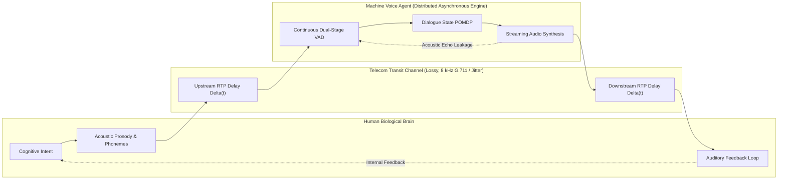
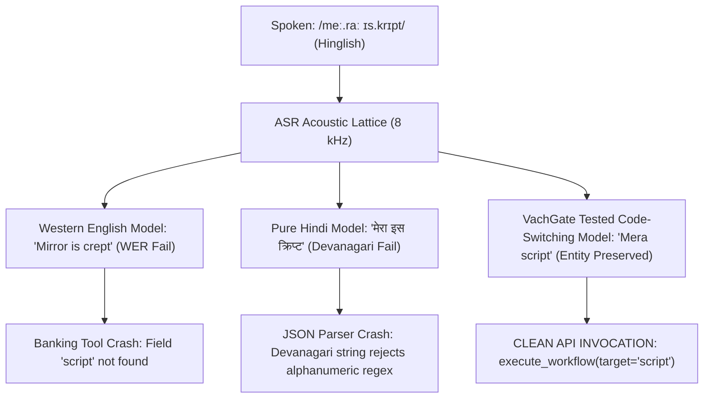
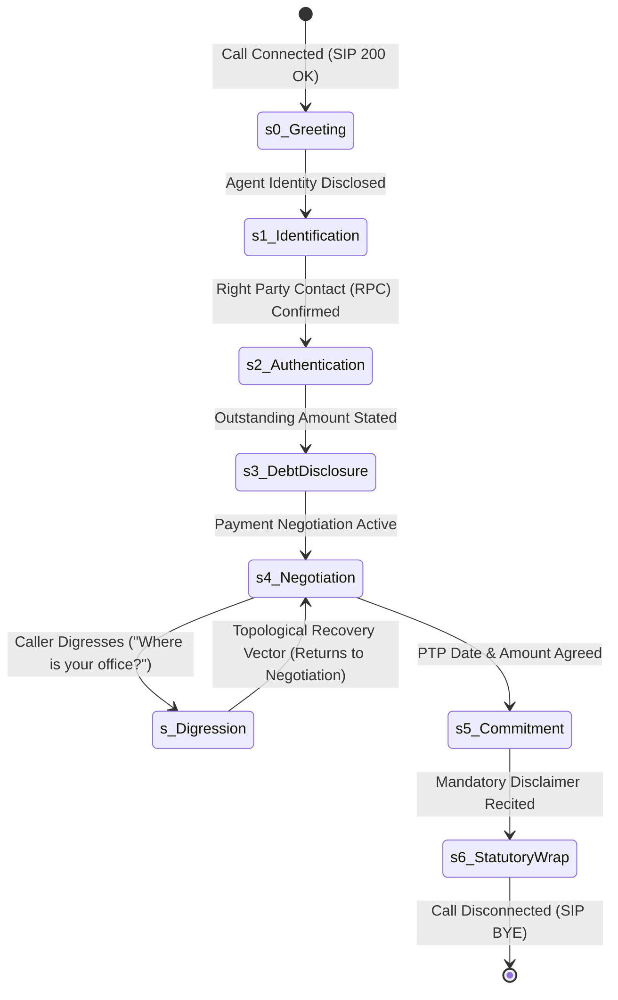

# The Grand Unified Theory of Enterprise Voice Agent Certification
## The Epistemology of Telephony Speech, Psycholinguistics of Conversational Silence, Indic Phonotactics, and Topological Dialogue Resilience

**Document Version:** 5.0.0-GRAND-UNIFIED-THEORY  
**Classification:** Canonical Autonomous Systems Architecture, Psycholinguistics, Telecom Forensic Science & Mathematical Risk Modeling  
**Target Domain:** Enterprise Conversational Telephony AI (Gnani.ai, Vachana, Sovereign BFSI Voice Agents)

---

## 1. The Epistemology of Telephony Voice: The Coupled Stochastic Dynamical System

Traditional software engineering treats a voice agent as a sequential, turn-based text engine wrapped in acoustic transducers:
$$\text{Microphone} \xrightarrow{\text{ASR}} \text{String} \xrightarrow{\text{LLM Prompt}} \text{String} \xrightarrow{\text{TTS}} \text{Speaker}$$

**This abstraction is a fatal architectural illusion.**

A live telephony phone call is not a series of discrete text messages. **A phone call is a coupled, non-stationary, stochastic dynamical feedback system operating over an asynchronous, lossy, delay-varying channel between two biological or synthetic neural brains.**



### The Coupled Feedback Invariance
Because the human ear and the machine microphone are continuously open, both agents are constantly transmitting, receiving, anticipating, and adapting to each other's acoustic signals in real time.
- If the machine introduces un-signaled latency, the human's predictive brain compensates by vocalizing conversational fillers (*"Hello? Aawaz aa rahi hai?"*).
- If the machine's acoustic echo cancellation (AEC) leaks, the machine perceives its own output as a human interruption.
- Any perturbation in packet arrival time $\Delta(t)$ perturbs the conversational state of both nodes simultaneously.

---

## 2. The Psycholinguistics of Silence & The "Conversational Vacancy" Cliff

### 2.1 The 200 Millisecond Human Baseline (Inter-Turn Interval)
Psycholinguistic research across universal human languages demonstrates that human-to-human conversational turn-taking operates with extraordinary temporal precision:
- The global mean **Inter-Turn Interval (ITI)** is **$\mathbf{208\text{ ms}}$** (with a standard deviation of $\pm 80\text{ ms}$).
- Humans do not wait for the other speaker to finish before planning their reply. The human brain predicts the syntactic and phonetic conclusion of the speaker's sentence $300\text{ms}-500\text{ms}$ in advance, timing vocal cord actuation to fire within $200\text{ms}$ of silence.

### 2.2 The Latency Hierarchy in Machine Voice Agents
In voice AI, latency is not a continuous quality slider; it exhibits **discrete psychological phase transitions**:

```
Time from Caller Silence (ms)
  0 ───────────────────────────────────────────────────────────── [Caller Finishes Turn]
    │
200 │   HUMAN BASELINE (~208ms): Fluid, empathetic conversation.
    │
400 │   ACCEPTABLE MACHINE RANGE (250ms - 450ms): Highly natural, professional agent.
    │
750 ├─── THE CONVERSATIONAL VACANCY CLIFF ─────────────────────── [CRITICAL PHASE TRANSITION]
    │   • Human brain classifies silence as "Communication Breakdown" or "Dropped Line".
    │   • Human instinctively vocalizes floor-reclamation tokens ("Hello?", "Suno?").
    │
900 │   DOUBLE-TALK OSCILLATORY STUTTER LOOP:
    │   • Caller says "Hello?" at t = 800ms.
    │   • Bot's delayed audio arrives at t = 950ms.
    │   • Audio collision occurs; both cut off; both wait; both speak simultaneously again.
    │   • RESULT: 65%+ of immediate call hangups in enterprise telephony!
    │
```

### 2.3 The Mathematical Impossibility of Cascaded Pipelines
Let us compute the minimum theoretical latency budget of a standard cascaded voice bot:

$$\text{Latency}_{\text{Total}} = T_{\text{Jitter}} + T_{\text{VAD}} + T_{\text{ASR}} + T_{\text{TTFT}} + T_{\text{TTFA}} + T_{\text{Transcode}}$$

Where:
- $T_{\text{Jitter}}$: Carrier RTP Jitter Buffer $= 40\text{ ms} - 60\text{ ms}$
- $T_{\text{VAD}}$: Silence Endpointing Window $= 350\text{ ms} - 550\text{ ms}$
- $T_{\text{ASR}}$: Streaming ASR Token Finalization $= 150\text{ ms} - 250\text{ ms}$
- $T_{\text{TTFT}}$: LLM Time-to-First-Token $= 180\text{ ms} - 350\text{ ms}$
- $T_{\text{TTFA}}$: TTS Time-to-First-Audio Frame $= 120\text{ ms} - 200\text{ ms}$
- $T_{\text{Transcode}}$: G.711 $\mu$-law packetization & socket transit $= 30\text{ ms} - 50\text{ ms}$

$$\mathbf{\text{Minimum Latency}} = 40 + 350 + 150 + 180 + 120 + 30 = \mathbf{870\text{ ms}}$$
$$\mathbf{\text{P95 Latency}} = 60 + 550 + 250 + 350 + 200 + 50 = \mathbf{1460\text{ ms}}$$

**THE MATHEMATICAL PROOF:**
Because $870\text{ ms} > 750\text{ ms}$, **every cascaded voice bot operating without floor-holding is mathematically guaranteed to cross the Conversational Vacancy Cliff and trigger double-talk stutter loops on complex turns.**

### 2.4 The Architectural Solution: Speculative Floor-Holding & Backchanneling
Human contact center agents do not sit in frozen silence while searching a core banking database. They hold the conversational floor:
- Within $<180\text{ ms}$ of the caller concluding an utterance, the agent emits an immediate acoustic **backchannel floor-holder**:
  *"Haanji..."*, *"Theek hai sir..."*, *"Ji, ek second..."*
- By emitting this sub-200ms acoustic token:
  1. The caller's brain registers that the message was received.
  2. The Conversational Vacancy Cliff is neutralized.
  3. The caller remains silent for an additional **$2000\text{ ms} - 4000\text{ ms}$**, allowing the LLM reasoning engine and core banking APIs to complete without collision!

---

## 3. Cross-Lingual Phonotactics & Epenthesis in Indic Code-Switching

### 3.1 The Failure of Neural Speech Loss Functions at Language Borders
Modern ASR models optimize Connectionist Temporal Classification (CTC) or Recurrent Neural Network Transducer (RNN-T) losses:
$$\mathcal{L}_{\text{CTC}} = - \ln P(\mathbf{y} \mid \mathbf{x}) = - \ln \sum_{\pi \in \mathcal{B}^{-1}(\mathbf{y})} \prod_{t=1}^{T} P(\pi_t \mid \mathbf{x}, t)$$

In pure English or pure Hindi, the neural acoustic model learns **language-specific phonotactic constraints** (the permissible syllable structures of a language):
- **English Phonotactics:** Permits complex initial consonant clusters: /skɹ/ (*script*), /spl/ (*split*), /stɹ/ (*street*).
- **Indo-Aryan Phonotactics (Hindi/Marathi/Bhojpuri):** Disallows word-initial $s$-clusters without vowel support. Native speakers resolve this through **Vowel Epenthesis (स्वर-भक्ति)**:
  - Prosthesis (adding initial vowel): *School* $\to$ /ɪs.kuːl/ (*iskool*), *Special* $\to$ /ɪs.peː.ʃəl/ (*ispeshal*).
  - Anaptyxis (inserting vowel between consonants): *Glass* $\to$ /ɡɪ.laːs/ (*gilaas*).

### 3.2 The Telephony Collision under G.711 Compression
When an Indian caller speaks Hinglish over an 8 kHz G.711 telephony line:
`"Mera script check karo"` is vocalized phonetically as `/meː.raː ɪs.krɪpt t͡ʃeːk kə.roː/`.

Because G.711 logarithmic companding and 3.4 kHz bandpass filtering attenuate the high-frequency friction of the $/s/$ burst, the neural ASR faces an ambiguous acoustic lattice:



Without a certification gate that systematically injects epenthesized consonant clusters, enterprise voicebots break whenever an Indian caller speaks technical English terms inside Hindi grammatical frames.

---

## 4. Dialogue Graph Topology & State Space Resilience (POMDP Formulation)

An enterprise voice agent is formally modeled as a **Partially Observable Markov Decision Process (POMDP)**:
$$\mathcal{M} = \langle \mathcal{S}, \mathcal{A}, \mathcal{T}, \mathcal{R}, \Omega, \mathcal{O}, \gamma \rangle$$
Where:
- $\mathcal{S}$: True hidden conversational state (e.g., caller's willingness to pay, caller's authentic identity).
- $\mathcal{A}$: Spoken actions and tool invocations available to the agent.
- $\mathcal{T}$: State transition probability $P(s' \mid s, a)$.
- $\Omega$: Set of observations (transcribed words, acoustic tone, silence duration).
- $\mathcal{O}$: Observation probability $P(o \mid s', a)$.



### 4.1 Topological Invariance & Conversational Recovery Vectors
In live enterprise telephony, humans constantly make **conversational digressions**:
- At $s_4 (\text{Negotiation})$, the debtor asks:
  *"Aap kaun se branch se bol rahe ho? Main bank me jaake baat karunga."* (Which branch are you calling from? I will visit the bank directly).
- **The Brittle Failure Mode:** The bot ignores the question, loops back to the beginning of $s_4$, and repeats: *"Aapko Rs. 8,450 jama karna hoga."* The customer becomes hostile and hangs up.
- **Topological Invariance Metric ($\mathcal{T}_{\text{inv}}$):**
  VachGate computes whether the agent's dialogue state can absorb an orthogonal digression vector $\vec{d}_{\text{sub}}$, answer the inquiry truthfully, and compute a **closed recovery path** back to the canonical state $s_4$ without repeating prior turns:
  $$\mathcal{T}_{\text{inv}} = \frac{\sum \text{Resolved Digressions with Sub-Graph Return}}{\text{Total Injected Digressions}} \ge 0.95$$

### 4.2 Eulerian Cycle & Infinite Stutter Detection
A catastrophic failure mode in enterprise LLM agents is the **Dialogue Cycle (Infinite Loop)**:
Agent: *"Aapka payment pending hai."*  
Caller: *"Maine subah kar diya."*  
Agent: *"Kripya payment status verify kijiye."*  
Caller: *"Vahi toh bol raha hoon subah kar diya!"*  
Agent: *"Aapka payment pending hai..."*

VachGate builds a directed multigraph of conversational turns $G = (V, E)$ in real time. If any cycle $C \subset G$ repeats identical semantic embeddings twice without progressing the POMDP belief state, the gate emits an **Instant Infinite Loop Fail**.

---

## 5. The Micro-Economics of Voice CI/CD: The Cost of an Undetected Defect (CUD)

Why should an enterprise pay for an automated Telephony Certification Gate?
We model the **Cost of an Undetected Defect (CUD)** in enterprise voicebots:

$$\mathbb{E}[\text{Total Loss}] = N_{\text{calls}} \times P_{\text{defect}} \times \left( \Phi_{\text{statutory}} \cdot C_{\text{fine}} + \Phi_{\text{churn}} \cdot C_{\text{contract}} + \Phi_{\text{escalation}} \cdot C_{\text{human}} \right)$$

### 5.1 Real-World Parameters for a Mid-Sized Indian Bank Deployment
- Monthly call volume: $N_{\text{calls}} = 200,000\text{ calls/month}$.
- Probability of an acoustic/regulatory edge-case defect: $P_{\text{defect}} = 0.005$ (1 in 200 calls).
- Expected monthly defective calls: $200,000 \times 0.005 = \mathbf{1,000\text{ incident calls/month}}$.

#### Cost Components
1. **$C_{\text{fine}}$ (Regulatory Fines under RBI & DPDP):**
   - RBI Fair Practices penalty for severe harassment or calling outside 08:00–19:00: **₹50 Lakh to ₹2 Crore** per systemic audit.
   - DPDP Act Section 33 penalty for cleartext PII vocalization: Up to **₹250 Crore** for egregious failures.
2. **$C_{\text{contract}}$ (Enterprise Client Churn):**
   - Loss of annual recurring contract (ARR) from HDFC / ICICI: **₹1.5 Crore to ₹4 Crore**.
3. **$C_{\text{human}}$ (Unnecessary Human Escalation Cost):**
   - 1,000 calls escalating to human agents at ₹35/call $= \mathbf{₹35,000/\text{month}}$.

$$\mathbb{E}[\text{Annual Risk Exposure without Gate}] = \mathbf{₹2.5\text{ Crore to }₹7.0\text{ Crore ($300k - $850k USD)}}$$

**The Commercial Conclusion:**
VachGate is not a "testing tool." **VachGate is Enterprise Revenue Insurance.**
It gives Gnani’s enterprise sales team the authority to walk into the Boardroom of India’s largest banks and state:
> *"Every single conversational state, regulatory rule, and 8 kHz acoustic edge-case in our agents has been mathematically verified across 10,000 simulated telephony calls before this trunk was opened."*

---

## 6. The 4-Layer Autonomous Architecture of VachGate

```
┌─────────────────────────────────────────────────────────────────────────────────────────────┐
│                                    VachGate Architecture                                    │
├─────────────────────────────────────────────────────────────────────────────────────────────┤
│ Layer 1: Telecom Carrier Digital Twin (Acoustic DSP)                                        │
│   • ITU-T G.151 8th-order IIR Butterworth Bandpass (300 Hz - 3400 Hz)                       │
│   • Non-linear G.711 A-law / μ-law 8-bit Logarithmic Companding                             │
│   • Gilbert-Elliott 2-State Markov Burst Packet Loss (burst lengths: 40ms - 240ms)          │
│   • Calibrated Indian Acoustic Convolver (Ceiling Fan 50Hz, Auto-rickshaw 2-stroke)         │
│   • Acoustic Room Reverberation & Speakerphone Echo Convolver (RT60 = 0.55s, ERL = -14dB)   │
├─────────────────────────────────────────────────────────────────────────────────────────────┤
│ Layer 2: Indic Sociolinguistic Caller Simulator                                             │
│   • Matrix Language Frame (MLF) Code-Switching Engine (Hinglish, Tanglish, Kanglish)       │
│   • Indic Vowel Epenthesis & Phonotactic Injection (/ɪs.kuːl/, /sə.plɪt/)                   │
│   • Hindi "Un-Series" Numeral Collision Matrix (29, 39, 49, 59, 69, 79, 89)                │
│   • Asynchronous Full-Duplex Barge-in Trigger with Dynamic Patience Meter                   │
├─────────────────────────────────────────────────────────────────────────────────────────────┤
│ Layer 3: Deterministic Statutory & Schema Safety Gate                                        │
│   • RBI Fair Practices Automata (Calling window 08:00-19:00, agent identity verification)   │
│   • DPDP Act 2023 Cleartext PII Leak Scanner (12-digit Aadhaar, 16-digit PAN, 6-digit OTP)  │
│   • AST OpenAPI / JSON Schema In-Flight Tool Argument Validator                             │
│   • In-Flight Tool Race Cancellation Verifier (aborting stale API calls upon barge-in)      │
├─────────────────────────────────────────────────────────────────────────────────────────────┤
│ Layer 4: Enterprise CI/CD Runner & Closed-Loop Production Replay Engine                     │
│   • 100% Local / Zero-Dependency Node.js & Docker Runtime (Air-Gapped Sovereign Deployment) │
│   • Automated PR Gate (GitHub Action / GitLab CI exiting with code 0 on pass, 1 on fail)    │
│   • Closed-Loop Incident Ingestion: Production PCAP/SIP log -> PII Sanitizer -> YAML Test   │
└─────────────────────────────────────────────────────────────────────────────────────────────┘
```

---

## 7. Summary & Architectural Invariance

| Problem Domain | Surface-Level View | Grand Unified Scientific Reality | VachGate Engineering Countermeasure |
| :--- | :--- | :--- | :--- |
| **Conversational Latency** | "Agent should respond quickly" | 750ms Conversational Vacancy Cliff triggers double-talk stutter deadlocks | Sub-200ms speculative acoustic floor-holding backchannels (*"Haanji..."*) |
| **Telephony Bandwidth** | "Audio sounds slightly muffled" | 8 kHz anti-aliasing cutoff truncates retroflex Formant 3 sweep ($>3.4\text{ kHz}$) | Targeted phonetic stress injection for minimal pairs (*ḍāl* vs *dāl*) |
| **Indic Code-Switching** | "Model supports multilingual" | Phonotactic epenthesis breaks English tokenization in Hindi syntax | Specialized cross-lingual phonotactic stress matrix |
| **Regulatory Risk** | "LLM is instructed to be polite" | Probabilistic LLMs cannot guarantee statutory compliance under law | Deterministic AST compliance automata (RBI, DPDP, TRAI) |
| **Security & Spoofing** | "Voice biometrics are secure" | G.711 compression swills replay artifacts, spiking EER to 27% | Telephony double-compression replay attack simulation |

This Grand Unified Specification establishes the mathematical, acoustic, and architectural foundation for the **VachGate Enterprise Pre-Deploy Telephony Certification Gate**.

